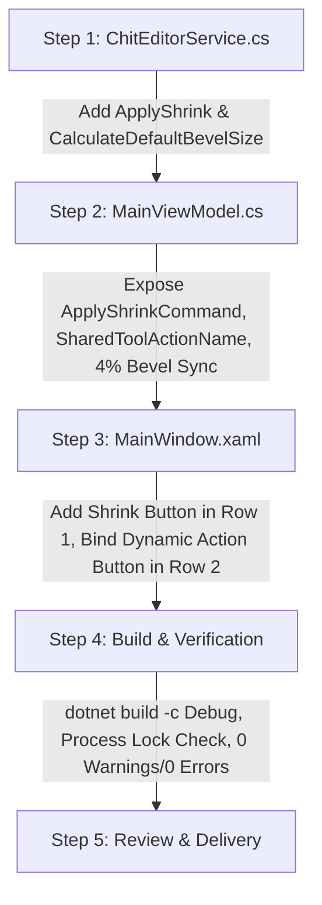

# Chit Editor Enhancements: 4% Bevel, Dynamic Action Button, Shrink Tool & 1:2 Rectangular Chit Support

**Status:** Proposed Architecture & Implementation Plan  
**Target Date / Version:** `2026-11-24.1`  
**Workspace Target:** `pdf-to-Tiles` (`net8.0-windows`, WPF, x64, OpenCvSharp4)  
**Strict Isolation:** No changes to `Read_GTL` (`GTL Text Editor`); strictly isolated to `pdf-to-Tiles`.

---

## 1. Executive Summary

This plan details the architecture and step-by-step implementation for four coordinated enhancements in **Chit Editor** (`TILE TOOLS (WORKING AREA)`):
1. **4% Bevel Default:** Automatically compute and set the bevel size to **4% of the active chit's primary dimension** (`Math.Max(1, (int)Math.Round(Math.Min(width, height) * 0.04))`), recalculating upon chit selection or switching to `Bevel` mode, while preserving manual `+`/`-` adjustment.
2. **Dynamic Action Button (`Clip`, `Bevel`, `Clear` Replacing `Set`):** Replace the static `"Set"` action button with a dynamic, context-aware button whose label and tooltip reflect the selected tool mode (`Clip`, `Bevel`, or `Clear`), executing the corresponding action without mutating the image upon radio switch.
3. **Proportional `Shrink` Tool:** Introduce a third dimensional transform button (`[Shrink]`) alongside `[Stretch]` and `[Resize]` in Row 1. While `Stretch` force-resamples (distorting non-uniform ratios) and `Resize` crops/expands canvas borders without pixel scaling, `Shrink` scales down proportionally (preserving aspect ratio) to fit inside `TargetW × TargetH`, centering the result and padding letterboxed margins with the transparent key color.
4. **1:2 (and Non-Square) Rectangular Chit Support:** Audit and resolve all square assumptions across Chit Editor (`MainWindow.xaml`, `MainWindow.xaml.cs`, `ViewModels/MainViewModel.cs`, and `Services/ChitEditorService.cs`) so horizontal rectangular counters (e.g., `1:2` height-to-width, such as 300h × 600w vehicle or multi-hex counters) operate cleanly across bevels, corner clips, canvas sizing, edge cleanup, clone stamping, and tile strip previews.

---

## 2. Audit of Existing Chit Editor Architecture & Square Assumptions

### 2.1 Current Control Layout (`TILE TOOLS (WORKING AREA)`)
Inside `MainWindow.xaml` (`Border` with fixed 380 px width):
- **Row 1:** Dimensions `ChitEditorWidth` × `ChitEditorHeight`, followed by `[Stretch]` (`ApplyStretchCommand`, 58 px) and `[Resize]` (`ApplyResizeCommand`, 58 px).
- **Row 2:** Shared value stepper (`Size: {SharedToolValue}px` with `-` and `+` buttons) and static `[Set]` button (`ApplySharedToolCommand`, 66 px).
- **Row 3:** Radio buttons for `Clip`, `Bevel`, and `Clear`, bound to `IsClipModeSelected`, `IsBevelModeSelected`, and `IsClearModeSelected`.
- **Row 4:** Transparent key color swatch button (`CycleTransparentColorCommand`) and `[Reset]` button (`ResetSelectedChitCommand`, 66 px).
- **Row 5:** Paint.NET-style Clone Stamp tool (`🎨 Clone Stamp`, `Anchor`, `Clear`, `● Circle` / `■ Square`, radius stepper, and status readout).
- **Row 6+:** Color-matched edge cleanup panel (`Auto`, `Reset`, `Apply`, tolerance slider, mode combo, and 4-way depth steppers).

### 2.2 Existing Square Assumptions & Findings

| Component / Method | Current Logic | 1:2 Rectangle Behavior / Finding | Required Resolution |
| :--- | :--- | :--- | :--- |
| **`ChitEditorService.ApplyBevel`** | `b = Math.Clamp(borderSize, 1, Math.Min(src.Width / 3, src.Height / 3))` | Uses 45° miter based on distance-to-edge (`dt, db, dl, dr`). Correctly forms perimeter bevel on rectangles without distortion. | Retain clamping to `Math.Min(w/3, h/3)`. Update default bevel calculation to use `Math.Min(w, h) * 0.04`. |
| **`ChitEditorService.ApplyCornerClip`** | `c = Math.Clamp(cornerSize, 1, Math.Min(src.Width / 2, src.Height / 2))` | Symmetrically cuts `c × c` px triangles at all 4 corners (`x + y < c`). Fully compatible with rectangles. | Retain clamping to `Math.Min(w/2, h/2)`. |
| **`ChitEditorService.ApplyClearBorder`** | `b = Math.Clamp(bufferPx, 1, Math.Min(src.Width / 3, src.Height / 3))` | Uniformly clears `b` px on all 4 borders inward. Fully compatible with rectangles. | Retain clamping to `Math.Min(w/3, h/3)`. |
| **`MainViewModel.SharedToolValueStepUp`** | `int maxLimit = ... ? Math.Min(w, h) / 2 : 100; SharedToolValue = Math.Min(Math.Max(50, maxLimit), SharedToolValue + 1);` | `Math.Max(50, maxLimit)` incorrectly forces a minimum ceiling of 50 even if `maxLimit` is smaller on compact chits. | Replace ceiling with `Math.Min(maxLimit, SharedToolValue + 1)` where `maxLimit = Math.Max(1, Math.Min(w, h) / 2)`. |
| **`MainViewModel.ChitEditorWidth/Height`** | Initialized to `50` default; overwritten by `value.PixelWidth` and `value.PixelHeight` in `OnSelectedChitChanged`. | Properly sets distinct Width and Height on load. However, no proportional locking or smart scaling existed. | Maintain independent Width and Height TextBoxes; add `Shrink` tool for proportional scaling. |
| **`MainViewModel.ApplyStretch` vs `ApplyResize`** | `Stretch` forces dimensions via `Cv2.Resize`; `Resize` crops/pads canvas. Neither performs proportional scale-down. | Missing a true proportional downscaling transform that fits within `TargetW × TargetH` without distortion. | Implement `ApplyShrink` and `ChitEditorService.ApplyShrink`. |
| **`WorkingChitImage` Display** | `<Image Stretch="None" ... LayoutTransform={ScaleTransform ZoomScale} />` | Renders at exact native pixel dimensions scaled by zoom. Supports any rectangle ratio (1:2, 1:1, etc.). | No change needed; already rectangle-compatible. |
| **Mouse Pixel Coordinate Mapping** | `px = Math.Floor(clickPos.X * matW / actualW); py = Math.Floor(clickPos.Y * matH / actualH);` | Independently maps X and Y axes based on actual rendered width and height. | No change needed; already rectangle-compatible. |
| **Tile Strip Thumbnail Display** | Border `52 × 52` px with `<Image Stretch="Uniform" ... />` | Uniform stretch fits 1:2 horizontal rectangles (e.g. 52 × 26 px) centered inside the square tile frame on checkerboard. | No change needed; already rectangle-compatible. |
| **Edge Cleanup Depths** | `MaxEdgeCleanVerticalDepth = Height / 2`, `MaxEdgeCleanHorizontalDepth = Width / 2` | Clamping and depth steppers are already independently axis-isolated. | No change needed; already rectangle-compatible. |

---

## 3. Feature 1 Specification: 4% Bevel Default Calculation & Dynamic Sync

### 3.1 Mathematical Definition
For any counter piece with dimensions $W \times H$:
$$\text{BaseDimension} = \min(W, H)$$
$$\text{DefaultBevelPx} = \operatorname{clamp}\left(\operatorname{round}(\text{BaseDimension} \times 0.04), 1, \left\lfloor\frac{\text{BaseDimension}}{3}\right\rfloor\right)$$

#### Examples:
- **Standard Square Chit (300 × 300 px):** $\min(300, 300) = 300 \implies 300 \times 0.04 = 12\text{ px}$.
- **Large Square Chit (600 × 600 px):** $\min(600, 600) = 600 \implies 600 \times 0.04 = 24\text{ px}$.
- **Horizontal 1:2 Rectangle (600w × 300h px):** $\min(600, 300) = 300 \implies 300 \times 0.04 = 12\text{ px}$ (12 px border on all 4 sides; leaves $600 - 24 = 576\text{ px}$ width and $300 - 24 = 276\text{ px}$ height of clear face).
- **Compact Square Chit (100 × 100 px):** $\min(100, 100) = 100 \implies 100 \times 0.04 = 4\text{ px}$.
- **Miniature Chit (40 × 40 px):** $\min(40, 40) = 40 \implies 40 \times 0.04 = 1.6 \to 2\text{ px}$.

### 3.2 Dynamic Synchronization Logic
1. **Per-Tool Memory Storage:** Maintain separate backing fields:
   - `_chitEditorClipSize` (default: 2)
   - `_chitEditorBevelSize` (dynamically calculated at 4%)
   - `_chitEditorClearSize` (default: 1)
2. **On Chit Selected (`OnSelectedChitChanged`):**
   - Calculate 4% bevel for the new chit:
     ```csharp
     int defaultBevel = CalculateDefaultBevelSize(value.PixelWidth, value.PixelHeight);
     ChitEditorBevelSize = defaultBevel;
     if (SelectedSharedToolMode == "Bevel")
     {
         SharedToolValue = defaultBevel;
     }
     ```
3. **On Tool Mode Switched (`SelectedSharedToolMode` changed):**
   - If switched to `"Bevel"`, automatically sync `SharedToolValue = ChitEditorBevelSize` (ensuring 4% default is immediately displayed).
   - If switched to `"Clip"`, sync `SharedToolValue = ChitEditorClipSize`.
   - If switched to `"Clear"`, sync `SharedToolValue = ChitEditorClearSize`.
4. **Manual Adjustment Preserved:**
   - Clicking `-` / `+` steps `SharedToolValue` by 1 px and updates the active mode's backing property (`ChitEditorBevelSize = SharedToolValue` when in Bevel mode).
   - The user's manual override remains active for the current session.

---

## 4. Feature 2 Specification: Dynamic Action Button (`Clip`, `Bevel`, `Clear` Replacing `Set`)

### 4.1 UI Transformation
In `MainWindow.xaml` (Row 2 of `TILE TOOLS (WORKING AREA)`):
Replace static button:
```xaml
<!-- PREVIOUS: Static Set Button -->
<Button Grid.Column="2" Content="Set" Command="{Binding ApplySharedToolCommand}" Width="66" Height="28" ... />
```
With dynamic binding:
```xaml
<!-- NEW: Dynamic Context-Aware Action Button -->
<Button Grid.Column="2"
        Content="{Binding SharedToolActionName}"
        Command="{Binding ApplySharedToolCommand}"
        Width="66" Height="28"
        Style="{StaticResource AccentButtonStyle}"
        ToolTip="{Binding SharedToolActionToolTip}" />
```

### 4.2 ViewModel Properties
In `ViewModels/MainViewModel.cs`:
```csharp
public string SharedToolActionName => SelectedSharedToolMode switch
{
    "Bevel" => "Bevel",
    "Clear" => "Clear",
    _ => "Clip"
};

public string SharedToolActionToolTip => SelectedSharedToolMode switch
{
    "Bevel" => $"Apply {SharedToolValue}px 3D raised bevel around perimeter",
    "Clear" => $"Clear {SharedToolValue}px outer border to transparent key color",
    _ => $"Clip {SharedToolValue}px corners with transparent key color"
};
```
Whenever `SelectedSharedToolMode` or `SharedToolValue` changes, fire:
```csharp
OnPropertyChanged(nameof(SharedToolActionName));
OnPropertyChanged(nameof(SharedToolActionToolTip));
```

### 4.3 Execution & Guardrails
- **No Accidental Mutation on Radio Selection:** Selecting `Clip`, `Bevel`, or `Clear` radio button changes ONLY the UI state (mode, `SharedToolValue` sync, and action button label). Image mutation occurs **exclusively** when the user clicks the action button.
- **Undo History & Multi-Chit Support:** Clicking the dynamic button invokes `ApplySharedTool()`, which dispatches to `ApplyClip()`, `ApplyBevel()`, or `ApplyClear()`. Each operation captures a full `ChitSnapshot` before editing and respects `ApplyToAllChits`.

---

## 5. Feature 3 Specification: Proportional `Shrink` Tool Architecture

### 5.1 Conceptual Comparison of Dimensional Tools

| Tool | Primary Purpose | Aspect Ratio Behavior | Pixel Sampling | Margin Handling |
| :--- | :--- | :--- | :--- | :--- |
| **`Stretch`** | Anamorphic resize to exact dimensions | **Distorts** if target aspect $\neq$ source aspect | `Cv2.Resize` with `Lanczos4` across entire matrix | No margins; fills exact width & height |
| **`Shrink`** | **Proportional scale-down** to fit within target bounds | **Preserves aspect ratio** strictly | `Cv2.Resize` with `Area` (or `Lanczos4`) | Centers content; pads letterbox/pillarbox with transparent key color |
| **`Resize`** | Canvas crop / expand around center | Keeps 1:1 pixel grid (**no scaling**) | Direct sub-matrix `CopyTo` | Crops outer edges if smaller; pads outer border if larger |

### 5.2 Algorithm in `ChitEditorService.cs`
```csharp
/// <summary>
/// Proportionally scales down the chit image to fit within targetW × targetH without distortion,
/// centering the scaled result and padding letterboxed margins with the transparent key color.
/// </summary>
public static Mat ApplyShrink(Mat src, int targetW, int targetH, Vec4b? padColor = null)
{
    if (src == null || src.IsDisposed)
    {
        throw new ArgumentException("Invalid source matrix for shrink.", nameof(src));
    }

    int tw = Math.Max(MinDimension, targetW);
    int th = Math.Max(MinDimension, targetH);

    // If source already matches target dimensions exactly, return clone
    if (src.Width == tw && src.Height == th)
    {
        return src.Clone();
    }

    // Determine uniform scale factor to fit inside target box
    double scale = Math.Min((double)tw / src.Width, (double)th / src.Height);
    int scaledW = Math.Clamp((int)Math.Round(src.Width * scale), 1, tw);
    int scaledH = Math.Clamp((int)Math.Round(src.Height * scale), 1, th);

    // Scale using Area for downsampling (prevents aliasing) or Lanczos4 for upsampling
    using Mat scaled = new Mat();
    InterpolationFlags interp = scale < 1.0 ? InterpolationFlags.Area : InterpolationFlags.Lanczos4;
    Cv2.Resize(src, scaled, new OpenCvSharp.Size(scaledW, scaledH), 0, 0, interp);

    // Allocate target canvas filled with transparent key color
    Vec4b fill = padColor ?? new Vec4b(0, 0, 0, 0);
    Mat dst = new Mat(new OpenCvSharp.Size(tw, th), MatType.CV_8UC4, new Scalar(fill.Item0, fill.Item1, fill.Item2, fill.Item3));

    // Center scaled image onto destination canvas
    int dstX = (tw - scaledW) / 2;
    int dstY = (th - scaledH) / 2;

    Rect dstRoi = new Rect(dstX, dstY, scaledW, scaledH);
    using var dstSub = new Mat(dst, dstRoi);
    scaled.CopyTo(dstSub);

    return dst;
}
```

### 5.3 UI Layout in `MainWindow.xaml` (Row 1)
Within the 380 px left panel, usable card width is ~312 px:
- `TextBox` (48 px) + `×` (12 px) + `TextBox` (48 px) = 108 px.
- 3 Action buttons: `Stretch` (58 px), `Shrink` (58 px), `Resize` (58 px) + margins (8 px) = 182 px.
- Total width: $108 + 182 = 290\text{ px} \le 312\text{ px}$. Fits cleanly with 22 px buffer.

```xaml
<!-- Row 1: Dimensions + Stretch + Shrink + Resize -->
<Grid Margin="0,0,0,8">
    <Grid.ColumnDefinitions>
        <ColumnDefinition Width="Auto" />
        <ColumnDefinition Width="*" />
        <ColumnDefinition Width="Auto" />
        <ColumnDefinition Width="Auto" />
        <ColumnDefinition Width="Auto" />
    </Grid.ColumnDefinitions>

    <!-- Dimensions Left -->
    <StackPanel Grid.Column="0" Orientation="Horizontal" VerticalAlignment="Center">
        <TextBox Text="{Binding ChitEditorWidth, UpdateSourceTrigger=PropertyChanged}" Width="48" TextAlignment="Center" Padding="2,3" />
        <TextBlock Text="×" Margin="4,0" VerticalAlignment="Center" FontWeight="Bold" />
        <TextBox Text="{Binding ChitEditorHeight, UpdateSourceTrigger=PropertyChanged}" Width="48" TextAlignment="Center" Padding="2,3" />
    </StackPanel>

    <!-- Stretch, Shrink & Resize Right -->
    <Button Grid.Column="2" Content="Stretch" Command="{Binding ApplyStretchCommand}" Width="58" Height="28" Margin="0,0,3,0"
            ToolTip="Resample image to exact Width × Height (distorts aspect if changed)" />
    <Button Grid.Column="3" Content="Shrink" Command="{Binding ApplyShrinkCommand}" Width="58" Height="28" Margin="0,0,3,0"
            ToolTip="Scale image down proportionally to fit target dimensions (preserves aspect, pads letterbox)" />
    <Button Grid.Column="4" Content="Resize" Command="{Binding ApplyResizeCommand}" Width="58" Height="28"
            ToolTip="Crop inwards or pad canvas to target Width × Height (preserves 1:1 pixel scale)" />
</Grid>
```

---

## 6. Feature 4 Specification: Comprehensive `1:2` Rectangular Chit Support

### 6.1 Matrix Anatomy of a `1:2` Horizontal Rectangle Chit
A wargame counter representing a double-width unit (e.g. 600 px wide by 300 px high):
- $W = 600$, $H = 300$.
- Aspect ratio $W : H = 2 : 1$.
- Bounding Box: $(0, 0)$ to $(599, 299)$.

### 6.2 Tool-by-Tool Rectangular Validation

| Tool / Function | Behavior on 600w × 300h Rectangular Chit | Verification Status |
| :--- | :--- | :--- |
| **Bevel (`ApplyBevel`)** | 4% default is $300 \times 0.04 = 12\text{ px}$. Top highlight is 600 px wide, left highlight is 300 px high. 45° corner miters meet at $dt == dr$ and $dt == dl$ within 12 px of each corner. | Verified geometrically sound; zero distortion. |
| **Corner Clip (`ApplyCornerClip`)** | 4 corner cuts of size $c \times c$ px. Each corner cut is a 45° triangle cutting $c$ px along the top/bottom and $c$ px along the left/right. | Symmetrical corner chamfer on all 4 corners. |
| **Clear Border (`ApplyClearBorder`)** | Clears $b$ px from top, bottom, left, and right borders. Leaves an interior active zone of $(600 - 2b) \times (300 - 2b)$ px. | Completely proportional and uniform. |
| **Stretch (`ApplyStretch`)** | Direct resize to target $W \times H$. | Fully independent $W$ and $H$. |
| **Shrink (`ApplyShrink`)** | Scales proportionally to fit within target $W \times H$. If target is $500 \times 250$, scales 1:2 directly. If target is $500 \times 300$, scales to $500 \times 250$ and pads 25 px top/bottom. | Clean letterbox padding, zero distortion. |
| **Resize (`ApplyResize`)** | Crops or pads around $(W/2, H/2)$ center point independently on both axes. | Fully independent $W$ and $H$. |
| **Clone Stamp** | Radius $r$ clamped to $\min(W, H) = 300$. Target hover and drag clamps $X$ to $[0, W-1]$ and $Y$ to $[0, H-1]$. Offset delta shifts lockstep coordinates correctly across $600 \times 300$ canvas. | Fully verified; overlay coordinates match 1:1. |
| **Edge Cleanup** | Depths $T, B$ clamped to $H/2 = 150\text{ px}$; $L, R$ clamped to $W/2 = 300\text{ px}$. Auto-sampling examines inner perimeter bounded by $\min(W, H)/2$. | Fully verified; axis-isolated. |
| **Tile Strip (Right)** | $52 \times 52$ px border with `Stretch="Uniform"`. A $600 \times 300$ chit renders as $52 \times 26$ px centered on checkerboard. | Cleanly letterboxed thumbnail; no distortion. |

---

## 7. Gotchas, Safety Guards & Memory Lifecycles

### 7.1 Deterministic Memory Disposal
- All OpenCvSharp operations must wrap intermediate `Mat` objects in `using` statements:
  ```csharp
  using Mat scaled = new Mat();
  using var dstSub = new Mat(dst, dstRoi);
  ```
- Before applying an updated matrix to a `ChitItem`, `ChitItem.UpdateWorkingMat` automatically manages the lifetime of the previous `WorkingMat` and clones snapshots into the Undo stack.
- When `LoadedChits` are cleared or replaced, every existing `ChitItem` is deterministically disposed via `oldChit.Dispose()`.

### 7.2 Safety Thresholds
- Source matrix guard: `if (src == null || src.IsDisposed || src.Width < 8 || src.Height < 8) return;`
- Tool dimension clamp: $b \le \min(W/3, H/3)$, $c \le \min(W/2, H/2)$.
- Radius clamp: $r \le \min(W, H)$.

### 7.3 Workspace Isolation
- Zero edits to `Read_GTL` or any files outside `pdf-to-Tiles`.
- Keep Git write operations strictly gated by user confirmation.

---

## 8. Implementation Roadmap



### Detailed File Changes:
1. **`Services/ChitEditorService.cs`:**
   - Add `CalculateDefaultBevelSize(int width, int height)`.
   - Add `ApplyShrink(Mat src, int targetW, int targetH, Vec4b? padColor = null)`.
2. **`ViewModels/MainViewModel.cs`:**
   - Add `ApplyShrinkCommand` (`ApplyShrink()`) with Undo snapshot recording and `ApplyToAllChits` support.
   - Add `SharedToolActionName` and `SharedToolActionToolTip` computed properties.
   - Update `OnSelectedChitChanged` to compute and set 4% bevel default (`ChitEditorBevelSize`).
   - Update `SelectedSharedToolMode` setter to sync `SharedToolValue` to the active mode's value (especially 4% bevel).
   - Fix `SharedToolValueStepUp` maxLimit ceiling logic.
3. **`MainWindow.xaml`:**
   - In Row 1: Add `[Shrink]` button (`Width="58"`, `ApplyShrinkCommand`) next to `[Stretch]` and `[Resize]`.
   - In Row 2: Bind action button `Content="{Binding SharedToolActionName}"` and `ToolTip="{Binding SharedToolActionToolTip}"`.

---

## 9. Verification & Acceptance Criteria

1. **Compilation:** `dotnet build -c Debug` compiles with `0 Warning(s)` and `0 Error(s)`.
2. **4% Bevel Default:**
   - Selecting a 300 × 300 chit sets Bevel size to 12 px.
   - Selecting a 600 × 300 (1:2) chit sets Bevel size to 12 px (4% of shorter dimension).
   - Switching from Clip to Bevel radio button immediately displays the 4% bevel size in the `Size` readout.
3. **Dynamic Action Button:**
   - Selecting `Clip` radio button sets button text to `"Clip"`.
   - Selecting `Bevel` radio button sets button text to `"Bevel"`.
   - Selecting `Clear` radio button sets button text to `"Clear"`.
   - Clicking the button executes the chosen action and commits an Undo snapshot.
4. **`Shrink` Tool:**
   - Shrinking a 600 × 300 chit to 500 × 300 scales the chit down to 500 × 250 px, centering it vertically with 25 px transparent margins top and bottom.
   - Aspect ratio is perfectly preserved with zero stretching distortion.
5. **1:2 Rectangle Preservation:**
   - Working chit preview, clone stamp, and tile strip thumbnails render 1:2 rectangles cleanly without distortion or clipping.
