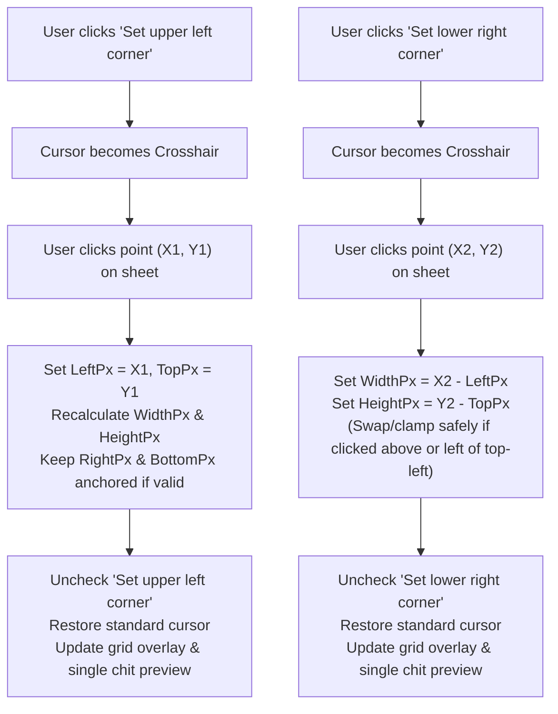

# Slicer Corner Click & Per-Pixel Bounding Box Refinement Plan

**Date:** 2026-11-23  
**Application:** PDF to Tiles (`pdf-to-Tiles`)  
**Target Solution:** WPF Desktop Application (`net8.0-windows` x64, .NET 8.0 / C# 12)  
**Status:** Strictly Read-Only Architecture & Implementation Plan  
**Target Version for Next Release:** `2026-23-11.13`  
**Reference Asset:** `media_1795468612370_3aaecc61.jpg` (*Armada* Counter Section Nr. 1 Front Scan, `6567 × 4148 px`)

---

## 1. Executive Summary & Root Cause Analysis

### 1.1 The Multi-Section Sheet Problem (*Armada* `6567 × 4148 px`)
In `media_1795468612370_3aaecc61.jpg`, the user loaded the counter sheet for SPI's 1979 game *Armada* (Counter Section Nr. 1, 200 pieces, `6567 × 4148 px`). 

Unlike *WorldKiller* (which spans 10 columns across the full sheet width), *Armada* is laid out as **two side-by-side columns of 2×10 counter blocks**:
- **Left Column (~48% of sheet width):** Spanish Naval (yellow, top 2×10), Spanish Land (tan, bottom 2×10).
- **Right Column (~48% of sheet width):** English Naval (red, top 2×10), English Land & Allies (pink/tan, bottom 2×10).
- **Vertical Center Gutter:** A narrow blank margin dividing the Spanish counters from the English counters.

### 1.2 Identified Root Causes in the Current Implementation
1. **Artificial Minimum Width Floor (`50%`):**
   - In `MainWindow.xaml` (line 538):
     ```xml
     <Slider Grid.Column="2" Minimum="50" Maximum="100" Value="{Binding ActiveBandWidthPercent}" ... />
     ```
   - In `ViewModels/MainViewModel.cs` (lines 1017, 1024):
     ```csharp
     ActiveBandWidthPercent = Math.Clamp(Math.Round(ActiveBandWidthPercent - 0.1, 1), 50.0, 100.0);
     ```
   - **Impact:** The bounding box **cannot shrink narrower than 50.0% of the sheet**. On *Armada*, where each half is ~`47.5%` to `48.2%` wide, it is mathematically impossible in the UI to bound a single 2×10 block—the box always extends across the center gutter and cuts into the neighboring nation's counters.
2. **Coarse Percentage Quantization & Lack of 1-Pixel Precision:**
   - Sliders and nudge commands operate on `0.1%` increments of sheet dimensions.
   - On a `6567 px` wide scan:
     $$0.1\% \times 6567\text{ px} \approx 6.57\text{ px}$$
   - On a `4148 px` high scan:
     $$0.1\% \times 4148\text{ px} \approx 4.15\text{ px}$$
   - Each nudge jumps by **~7 pixels horizontally** and **~4 pixels vertically**. Users cannot make 1-pixel, 2-pixel, or 3-pixel adjustments to align cut lines with counter borders.
3. **One-Ended Corner Definition (`Set upper left corner` only):**
   - The user can click to place the top-left corner, but has no matching tool to click and set the bottom-right corner.
   - When the user clicks the top-left of a counter block, the huge default width (e.g. `92%` or `50%`) remains active, forcing the user to struggle with coarse sliders to pull the right and bottom edges back into place.

---

## 2. Audit of Existing Coordinate Pipeline

### 2.1 Model Persistence (`Models/SheetProfile.cs` & `Models/Band2x10Definition.cs`)
- `Band2x10Definition.Bounds` is defined as:
  ```csharp
  public class GridRelativeBounds
  {
      public double Left { get; set; } = 0.05;
      public double Top { get; set; } = 0.05;
      public double Width { get; set; } = 0.90;
      public double Height { get; set; } = 0.90;
  }
  ```
- `RowSplitRatio` is a normalized float `0.10` to `0.90` (fraction of total band height allocated to Row 0).
- `ColumnDividers` is a list of 9 normalized positions `0.0 .. 1.0` within `Bounds.Width`.

**Preservation Mandate:**  
Storing `Bounds` as normalized `0.0..1.0` ratios is critical for profile portability across varying scan resolutions (e.g. 300 DPI vs 600 DPI vs 450 DPI). When saving/loading `SheetProfile` JSON files, relative ratios must continue to be serialized so existing profiles (such as *WorldKiller*) load without schema breakage.

### 2.2 Slicer & Overlay Conversions
In `MainWindow.xaml.cs` (`UpdateGridOverlay`):
```csharp
double abx = activeBand.Bounds.Left * imgW;
double aby = activeBand.Bounds.Top * imgH;
double abw = activeBand.Bounds.Width * imgW;
double abh = activeBand.Bounds.Height * imgH;
```
In `GridSlicerService.cs` (`ExtractBandedCellPreview` and `SliceBandedGridToMemoryAsync`):
```csharp
int bandX = (int)Math.Round(band.Bounds.Left * masterMat.Width);
int bandY = (int)Math.Round(band.Bounds.Top * masterMat.Height);
int bandW = (int)Math.Round(band.Bounds.Width * masterMat.Width);
int bandH = (int)Math.Round(band.Bounds.Height * masterMat.Height);
```
Both the overlay and slicing engines currently derive integer pixel coordinates directly from `Bounds.* * Dimension`.

---

## 3. Architecture for Dual-Corner Clicking & Per-Pixel Refinement

### 3.1 Pixel-Coordinate Data Binding Model
In `ViewModels/MainViewModel.cs`, introduce native integer pixel properties synchronized with `band.Bounds`:

```
┌────────────────────────────────────────────────────────────────────────┐
│                        MainViewModel State                             │
│                                                                        │
│  [Integer Pixel Properties]             [Normalized Band Bounds]       │
│  • ActiveBandLeftPx     (0..W-20)   ◄──► • band.Bounds.Left   (0..1)   │
│  • ActiveBandTopPx      (0..H-4)    ◄──► • band.Bounds.Top    (0..1)   │
│  • ActiveBandWidthPx    (20..W-L)   ◄──► • band.Bounds.Width  (0..1)   │
│  • ActiveBandHeightPx   (4..H-T)    ◄──► • band.Bounds.Height (0..1)   │
│  • ActiveBandRowSplitPx (2..H-2)    ◄──► • band.RowSplitRatio (0..1)   │
│                                                                        │
│  [Derived Computed Readouts]                                           │
│  • ActiveBandRightPx  = LeftPx + WidthPx                               │
│  • ActiveBandBottomPx = TopPx + HeightPx                               │
│  • ActiveBandDimensionsText = $"{WidthPx} × {HeightPx} px"             │
└────────────────────────────────────────────────────────────────────────┘
```

#### Bidirectional Conversion Math:
When `SlicerPixelWidth > 0` and `SlicerPixelHeight > 0`:
$$\text{LeftPx} = \text{round}(\text{Bounds.Left} \times W), \quad \text{Bounds.Left} = \frac{\text{LeftPx}}{W}$$
$$\text{TopPx} = \text{round}(\text{Bounds.Top} \times H), \quad \text{Bounds.Top} = \frac{\text{TopPx}}{H}$$
$$\text{WidthPx} = \text{round}(\text{Bounds.Width} \times W), \quad \text{Bounds.Width} = \frac{\text{WidthPx}}{W}$$
$$\text{HeightPx} = \text{round}(\text{Bounds.Height} \times H), \quad \text{Bounds.Height} = \frac{\text{HeightPx}}{H}$$
$$\text{RowSplitPx} = \text{round}(\text{RowSplitRatio} \times \text{HeightPx}), \quad \text{RowSplitRatio} = \frac{\text{RowSplitPx}}{\text{HeightPx}}$$

### 3.2 Dual-Corner Crosshair Workflow
Add `IsSettingLowerRightCorner` in addition to `IsSettingUpperLeftCorner`.



#### Mutual Exclusion & Safety Rules:
1. **Mutual Exclusion:**
   - Setting `IsSettingUpperLeftCorner = true` immediately forces `IsSettingLowerRightCorner = false`.
   - Setting `IsSettingLowerRightCorner = true` immediately forces `IsSettingUpperLeftCorner = false`.
2. **Tab Deactivation & Escape:**
   - Pressing `Escape`, switching tabs, or deactivating the window immediately clears both flags and restores `Cursors.Arrow`.
3. **Corner Inversion / Swapping:**
   - If the user clicks `Set lower right corner` at a position to the left of `LeftPx` or above `TopPx`, the coordinates swap cleanly:
     $$\text{LeftPx} = \min(X_1, X_2), \quad \text{RightPx} = \max(X_1, X_2)$$
     $$\text{TopPx} = \min(Y_1, Y_2), \quad \text{BottomPx} = \max(Y_1, Y_2)$$
     $$\text{WidthPx} = \max(20, \text{RightPx} - \text{LeftPx})$$
     $$\text{HeightPx} = \max(4, \text{BottomPx} - \text{TopPx})$$

---

## 4. Proposed UI Wireframe for Left Sidebar (Tab 2)

Inside the `340 px` left sidebar, replace the coarse percentage card with a compact, high-precision per-pixel panel:

```
┌────────────────────────────────────────────────────────┐
│ 2×10 BAND BOUNDING BOX (PIXELS)                        │
├────────────────────────────────────────────────────────┤
│ [ ] Set upper left corner    [ ] Set lower right corner│
├────────────────────────────────────────────────────────┤
│ Left (X):   [◀] [-1] [  128 px  ] [+1] [▶]   ( 1.9%)   │
│ Top (Y):    [▲] [-1] [  269 px  ] [+1] [▼]   ( 6.5%)   │
│ Width:      [◀] [-1] [ 3120 px  ] [+1] [▶]   (47.5%)   │
│ Height:     [▲] [-1] [  614 px  ] [+1] [▼]   (14.8%)   │
│ Row Split:  [▲] [-1] [  307 px  ] [+1] [▼]   (50.0%)   │
├────────────────────────────────────────────────────────┤
│ Bounds: (128, 269) to (3248, 883) px                   │
│ Active Block: 3120 × 614 px (20 Chits, ~312 × 307 px)  │
└────────────────────────────────────────────────────────┘
```

### Control Specifications:
1. **Crosshair Checkbox Row:**
   - Two side-by-side checkboxes or toggle buttons: `Set upper left corner` and `Set lower right corner`.
   - Clear visual indication when active (accent border / highlight).
2. **Dimension Rows:**
   - **Label:** `60 px` wide (`Left (X):`, `Top (Y):`, `Width:`, `Height:`, `Row Split:`).
   - **Nudge Buttons:**
     - `◀` / `▶` (Left/Right nudges) and `▲` / `▼` (Top/Bottom nudges).
     - Standard `RepeatButton` with `Delay="250" Interval="35"` for smooth, rapid single-pixel holding.
   - **Direct Pixel Input `TextBox`:**
     - Width `68 px`, text centered.
     - Accepts typed integers (`128`, `128px`, `128 px`).
     - Commits on `Key.Enter` or `LostFocus`, clamping safely within `[0 .. SlicerPixelWidth]` or minimum dimensions.
   - **Percentage Readout:**
     - Compact secondary readout (`(47.5%)`) for instant macroscopic context without obscuring exact pixel values.

---

## 5. Optional Canvas Drag Handles Evaluation

### Feasibility Analysis
- `SlicerGridCanvas` sits inside `SlicerScrollViewer`.
- If interactive handles (8 thumbs: 4 corners + 4 edge centers) are overlaid on `SlicerGridCanvas`:
  - When the user clicks and drags a handle, `Thumb.DragDelta` captures the mouse.
  - Coordinate scaling from screen pixels to image pixels:
    $$\Delta\text{px} = \Delta\text{screen} \times \frac{\text{SlicerPixelWidth}}{\text{imgW}}$$
  - **Pros:** Intuitive for visually pulling an edge closer.
  - **Cons:** On a `6567 px` scan viewed at `15%` zoom, 1 screen pixel = 6.6 image pixels. Dragging with a mouse at 15% zoom will feel jittery in 7-pixel increments. 
- **Recommendation:**
  Implement the **Dual-Corner Click (`Upper-Left` + `Lower-Right`)** and **Per-Pixel `±1 px` Nudge & Typed Input** first. Dual-corner clicking provides instant macroscopic positioning, and per-pixel nudging provides microscopic exactness. Interactive canvas handles can be added as a subsequent layer if desired without interfering with click-to-set.

---

## 6. Mandatory "Gotchas & Edge Cases" Check

1. **Normalized Profile Backward Compatibility:**
   - Existing profiles (`WorldKiller`, etc.) saved as JSON must continue loading seamlessly.
   - When converting from pixel coordinates back to normalized bounds:
     `band.Bounds.Left = Math.Clamp((double)LeftPx / SlicerPixelWidth, 0.0, 0.9999);`
     `band.Bounds.Width = Math.Clamp((double)WidthPx / SlicerPixelWidth, 0.001, 1.0 - band.Bounds.Left);`
   - Use `double` precision (avoid premature integer rounding of fractions) so saving a profile does not drift coordinates across repeatedly opened sessions.
2. **Zero/Negative Image Dimension Guards:**
   - Before an image is loaded, `SlicerPixelWidth == 0` and `SlicerPixelHeight == 0`.
   - All pixel property getters and setters must guard:
     `if (SlicerPixelWidth <= 0 || SlicerPixelHeight <= 0) return;`
   - Provide safe fallback values (e.g. nominal `3000 × 4000 px`) when no image is loaded so XAML design-time or empty startup does not throw `DivideByZeroException`.
3. **Crosshair Cursor & Mutual Exclusion:**
   - If user checks `Set upper left corner` and then checks `Set lower right corner`, `IsSettingUpperLeftCorner` must automatically be set to `false`.
   - When clicking outside the sheet image (e.g. on scrollbar or grey margins), do not commit invalid negative or out-of-bounds coordinates; cancel or ignore safely.
4. **Minimum Dimension Protection:**
   - A `2×10` band requires at least 10 columns and 2 rows.
   - Guard minimum dimensions: `WidthPx >= 20` (minimum 2 px per chit column) and `HeightPx >= 4` (minimum 2 px per chit row).
   - Guard row split: `RowSplitPx >= 2` and `RowSplitPx <= HeightPx - 2`.
5. **Overlay & Slicer Deterministic Sync:**
   - Every single-pixel change must trigger `UpdateChitPreview()` and `UpdateGridOverlay()`.
   - `GridSlicerService` already computes integer pixel cuts from `band.Bounds.Left * masterMat.Width`. By ensuring `band.Bounds` exactly mirrors `(double)LeftPx / masterMat.Width`, the preview, overlay, and exported PNGs will match down to the exact pixel.
6. **Workspace Isolation:**
   - Strictly zero edits to `GTL Text Editor`.
   - All modifications remain strictly isolated to `MainWindow.xaml`, `MainWindow.xaml.cs`, `ViewModels/MainViewModel.cs`, and `Models/SheetProfile.cs` (if helper properties are added).

---

## 7. Implementation Step-by-Step Plan

1. **Step 1: Add Dual-Corner Properties & Pixel Properties to `MainViewModel`**
   - Add `IsSettingLowerRightCorner` observable property.
   - Implement mutual exclusion between `IsSettingUpperLeftCorner` and `IsSettingLowerRightCorner`.
   - Add `ActiveBandLeftPx`, `ActiveBandTopPx`, `ActiveBandWidthPx`, `ActiveBandHeightPx`, `ActiveBandRowSplitPx`.
   - Wire bidirectional sync between pixel properties and `band.Bounds`.
   - Add single-pixel nudge commands (`NudgeActiveBandLeftPx(+/-1)`, `NudgeActiveBandTopPx(+/-1)`, etc.).
2. **Step 2: Update Mouse Click & Cursor Handling in `MainWindow.xaml.cs`**
   - Update `UpdateSlicerCursor()` to check both `IsSettingUpperLeftCorner` and `IsSettingLowerRightCorner`.
   - In `SlicerScrollViewer_PreviewMouseLeftButtonDown`, handle both top-left click and bottom-right click, calculating exact pixel positions on `_masterMat` without percentage quantization.
   - Add Esc key handling to cancel both corner picking modes.
3. **Step 3: Redesign 2×10 Bounding Box Card in `MainWindow.xaml`**
   - Replace the `Minimum="50"` percentage slider card with dual-corner crosshair checkboxes, direct pixel `TextBox` controls, `±1 px` `RepeatButton` controls, and secondary percentage labels.
4. **Step 4: Verify Compilation & Zero Drift**
   - Pre-build process lock check per `AGENT.md`.
   - Verify `dotnet build -c Debug` produces `0 Warning(s), 0 Error(s)`.
   - Test on *Armada* scan (`6567 × 4148 px`) to verify that the left column (Spanish block) can be framed cleanly at ~`3120 px` width with zero bleed into the English column.
